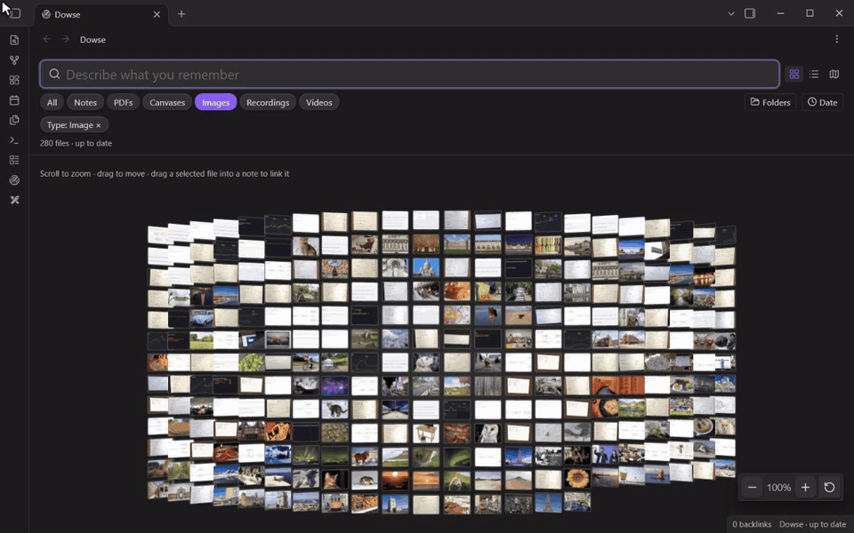
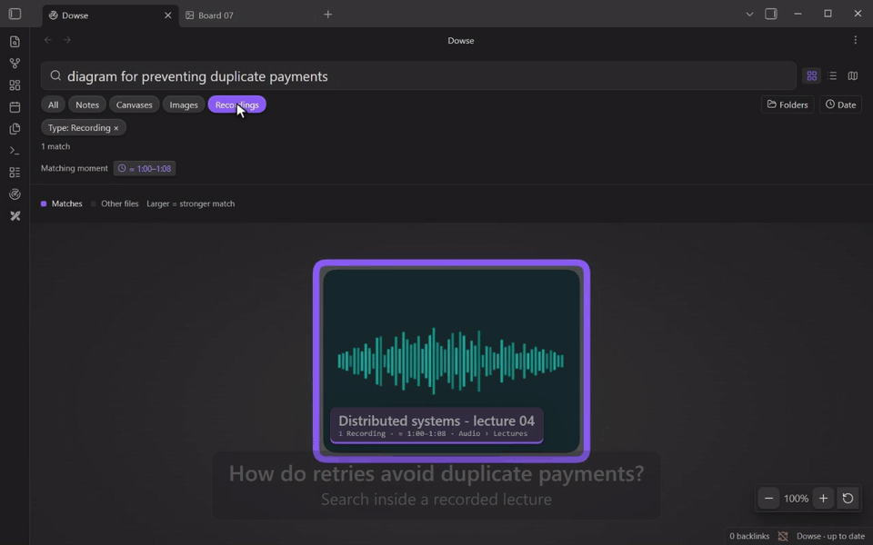
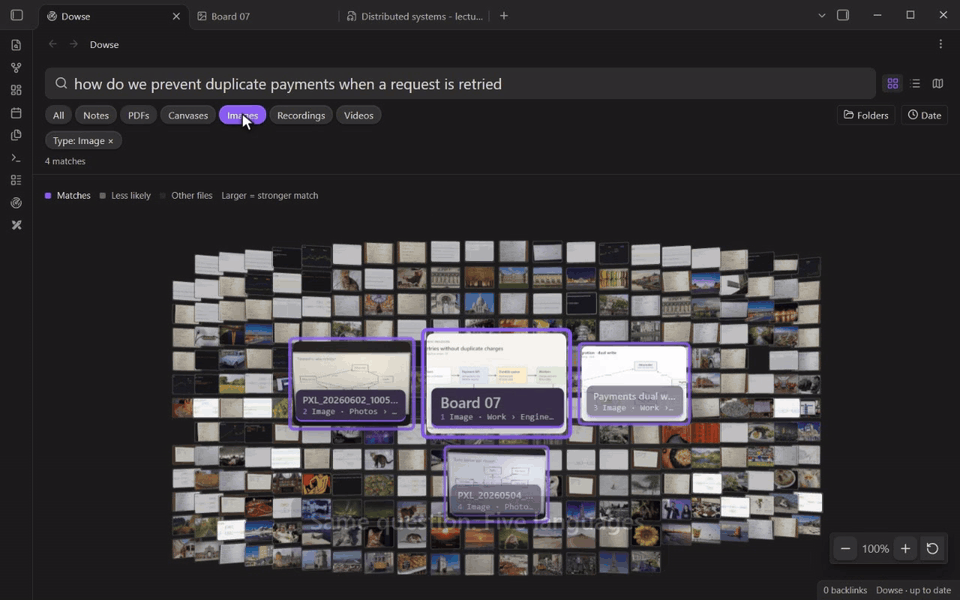
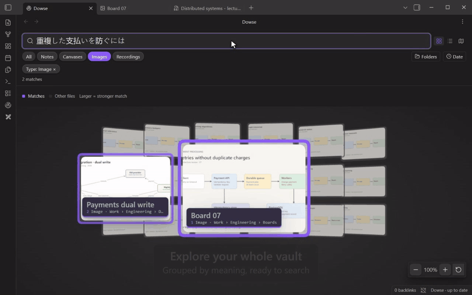
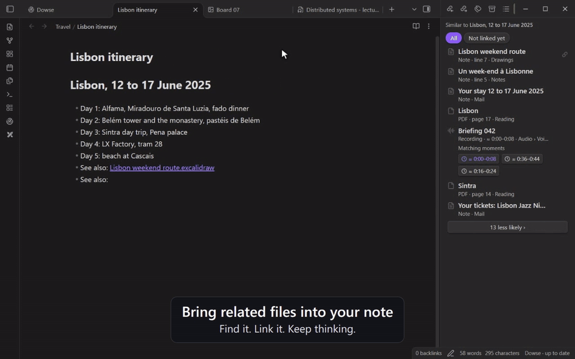

# Dowse for Obsidian

**Find what you remember, even when you forgot what you called it.**

Dowse searches your Obsidian vault by meaning: your notes, PDFs, images, recordings,
videos and canvases, together. Describe a diagram, ask about an idea from a lecture,
or find files related to the note you are writing. Results take you back to the
original file, its page, or an approximate matching moment.

The search model runs on your computer. **No account, API key or cloud search
service is required.**

**Desktop only · Free · In Obsidian's community plugins**

[See it in action](#see-it-in-action) · [Install](#install) · [Get started](#get-started)
· [Supported files](#supported-files) · [Privacy and requirements](#privacy-and-requirements)
· [Develop](#develop)

## See it in action

### Find a diagram by what it shows

Search for **“diagram for preventing duplicate payments”** and find the system
design saved as `Board 07`. Images and scans can be found by their contents, even
when their filenames give you little to go on.



### Find the explanation inside a recording

Choose **Recordings** and ask **“how do we prevent duplicate payments when a request is retried”**. Dowse
finds the lecture and offers **Matching moments**. Click a passage to open the
recording near the explanation—in this example, around **1:00**.



### Search in your own language

Ask the same question in **English, French, Arabic, Spanish or Japanese**. This
example finds the same English-language diagram across all five queries. You can
also search across languages in your notes and other supported content.



### Explore the connections in your vault

Browse files in a spatial view, grouped **By content** or **By folder**. A search
highlights the relevant files within the collection, and numbered results let you
move through them in rank order.



### Bring related files into the note you are writing

Open **Dowse: Show what's like this note** to find related notes, PDFs, images and
recordings in a sidebar. Choose **Not linked yet**, then click **Link** to insert a
reference into your note.



*Recorded in a demo vault using real Dowse searches. Matching passages are
approximate; results depend on the contents of your vault. [About the demos](docs/media/README.md).*

## Install

In Obsidian, open **Settings → Community plugins**, turn community plugins on if
needed, choose **Browse**, search for **Dowse**, then **Install** and **Enable**.
Obsidian keeps it up to date from there.

Then click the **Dowse ribbon icon**, or run **Dowse: Open the search tab** from the
command palette.

Installing the plugin does not start indexing or download a model. You choose
when to turn it on for each vault.

Dowse's `main.js` is about 7 MB, mostly the runtime that runs the model on your
computer. Obsidian Sync's Standard plan doesn't sync files over 5 MB, so on that
plan install Dowse on each computer from **Browse**.

<details>
<summary>Install by hand</summary>

Download `main.js`, `manifest.json` and `styles.css` from the
[latest release](https://github.com/WalidHadri-Iron/dowse-obsidian/releases/latest),
put them together in your vault's `.obsidian/plugins/dowse/` folder, then enable
**Dowse** under **Settings → Community plugins** (reload Obsidian if it isn't listed).
To update by hand, replace all three files together. You can also
[build from this repository](docs/development.md#build-and-package).

</details>

## Get started

1. Open the Dowse tab and choose whether to read **images** and **recordings/video
   sound**. Enable these for the visual and lecture examples above.
2. Choose **Turn on for this vault**. Dowse downloads the selected model parts once,
   then reads your files in the background. You can keep working and searching as
   the index grows.
3. Type what you are looking for. Use **List** for excerpts, the **fisheye gallery**
   for a visual collection, or **Explore** for spatial groups.
4. Narrow a search with file-type chips, **Folders** (multiple selections) and
   **Date**. Applied filters appear as removable chips, including filters inferred
   from your query.

For a quick search while writing, run **Dowse: Search the vault**. Assign it a
shortcut in **Settings → Hotkeys**. To leave something out, right-click a file or
folder and choose **Dowse: stop searching**.

Dowse distinguishes **matches** from **closest candidates** when nothing clearly
matches. Raw scores stay hidden. In the gallery, stronger matches appear larger
and move forward.

**[Read the usage guide](docs/usage.md)** for navigation, filters, exclusions,
matching moments, Excalidraw and settings.

## Supported files

| Content | What Dowse searches |
| --- | --- |
| Markdown notes | Text passages, with results opening at the relevant line. |
| PDFs | Text pages; scanned or mostly visual pages with image reading enabled. |
| Images and screenshots | Visual content with image reading enabled. |
| Audio recordings | What is said or heard, with approximate matching passages. |
| Videos | Sampled frames and, when enabled, their sound. |
| Obsidian Canvas | Text cards; group labels and linked-file names also support word searches. |
| Excalidraw `.excalidraw.md` | Readable text and descriptions. With the Excalidraw plugin, drawings preview and open as drawings. |

Excalidraw scene geometry is not visually indexed from the Markdown backing file.
Export a drawing as PNG to search its visual content. Standalone `.excalidraw`
JSON files are not indexed. [Formats and limits](docs/usage.md#formats-and-limits)
lists extensions and media restrictions.

## Privacy and requirements

- **Local processing.** Your vault content is processed on your computer. The
  initial model download comes from Hugging Face; search works offline once the
  selected model parts are cached. Vault content and queries are not sent to Hugging Face.
- **Desktop Obsidian.** Windows, macOS and Linux are supported; mobile is not.
  Obsidian 1.15+ also needs a recent installer/runtime. Dowse checks compatibility
  and explains when an installer update is needed.
- **GPU or processor.** Automatic mode uses WebGPU when available and falls back
  to the processor. You can choose the processor in **Settings → Dowse**.
- **One-time downloads.** Text is about **542 MB**. Images add about **336 MB**;
  audio adds about **587 MB**. The local index needs additional space depending
  on your vault.
- **Windows graphics preference.** If you explicitly change this option, Dowse reads
  installed display-adapter information and updates Windows’ per-user GPU preference
  for the Obsidian executable. This accesses the Windows registry outside the vault.
- **Recording limits.** Audio content search currently accepts files up to
  **20 minutes and 32 MiB**, with a **128 MiB decoded-audio limit**. Split longer
  lectures into shorter files. Oversize recordings remain searchable by filename;
  videos may still be searched by their frames.

Each vault has its own local index, stored outside the vault in Obsidian's storage.
It is not synced with your notes. The downloaded model is shared across vaults.
**Settings → Dowse** lets you pause reading, change media options, rebuild or remove
the index, and remove the cached model. Original files remain in your vault;
adding a link from the sidebar is an explicit action.

See [storage, privacy and troubleshooting](docs/usage.md#storage-and-privacy) for
details, including what remains after uninstalling.

## Develop

Use **Node.js 24**, npm and Python 3. The build also needs `xz` on Linux/macOS;
Windows can use Python's standard-library `lzma` support.

```sh
git clone https://github.com/WalidHadri-Iron/dowse-obsidian.git
cd dowse-obsidian
npm ci
npm run lint
npm run check
npm test
npm run build
python3 scripts/package.py
```

The installable plugin is in `build/dowse/`; the ZIP, checksums and commit metadata
are in `build/`. Install the three plugin files into a separate development vault
using the steps above.

The **[development guide](docs/development.md)** covers the repository layout,
development builds, native Obsidian testing, media-accuracy checks, CI and packaging.
[Measurements](measurements/README.md) records test results and their practical limits.

For a bug report, include your OS, Obsidian app/installer versions, Dowse version,
the steps to reproduce and a small non-private example where possible. For code
changes, describe the behavior and relevant validation in your pull request.

## License

Plugin code is available under the [MIT license](LICENSE). Model weights are
downloaded separately; see the
[upstream model repository](https://huggingface.co/onnx-community/embeddinggemma-2-ONNX)
for its terms.

Bundled dependency notices are included in [THIRD_PARTY_NOTICES.md](THIRD_PARTY_NOTICES.md)
and the release archive. The same license texts are embedded in `main.js` so
Obsidian’s three-file installer retains them.
